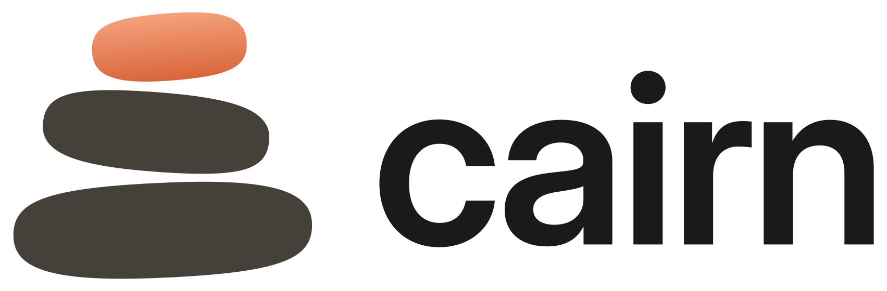

<p align="center">
  <picture>
    <source media="(prefers-color-scheme: dark)" srcset="brand/svg/logo-dark.svg">
    
  </picture>
</p>

<p align="center"><b>Everything you copy, a shortcut away.</b><br>A clipboard manager for macOS and Windows.</p>

Cairn keeps everything you copy, text, links, images, colours and files, and brings it back with one shortcut: <kbd>⌘⇧V</kbd> on a Mac, <kbd>Ctrl+Shift+V</kbd> (or <kbd>Win+V</kbd>) on Windows. Search it, pin favourites, paste as plain text, and keep password managers out of it.

## Download
Releases are on the [releases page](https://github.com/Hamza-Shewa/Yippy/releases):
- **macOS**: the newest `v` release, `Cairn-<version>.dmg`. Drag Cairn to Applications, then allow it in System Settings > Privacy & Security > Accessibility so it can paste for you.
- **Windows 10 and 11**: the newest `windows-v` release, `Cairn-<version>-setup.exe` (installer) or `Cairn-<version>-win-x64.exe` (portable). See [`windows/`](windows/README.md).

Cairn was called Yippy before macOS 3.0 and Windows 2.0. The new versions move your history, favourites and settings over on their first launch.

## Identity and design system
Cairn's name, logo, colours, type and spacing live in [`brand/`](brand/README.md). `brand/tokens.json` is the single source for both apps; `brand/generate.py` turns it into the Windows theme dictionaries, the macOS named colours and Swift constants, and every icon.

## Credits
Cairn is based on [Yippy](https://github.com/mattDavo/Yippy) by Matthew Davidson, and like Yippy it is open source under the [MIT License](LICENSE), which keeps both copyright notices. The libraries both apps ship with are listed in [THIRD_PARTY_NOTICES.md](THIRD_PARTY_NOTICES.md).

## Developing Cairn
### Contributions
All contributions are welcome, whether they are pull requests, bug reports, feature requests or general feedback.

### Project Structure
The code still uses Yippy as its internal name (the Xcode project, targets, schemes, Swift module and the Windows solution), so it stays easy to compare with the original. Only what users see is Cairn. There are 3 different schemes:
- Yippy, which builds `Cairn.app` (`com.hamzashewa.Cairn`)
- Yippy Beta, which builds `Cairn Beta.app` (`com.hamzashewa.CairnBeta`)
- Yippy XCTest, which builds the app for tests (`com.hamzashewa.CairnXCTest`)

__Yippy__ is used for running and archiving a production build. __Yippy Beta__ is used for development and archiving a beta release. __Yippy XCTest__ is used exclusively for running the unit and UI tests. `.github/workflows/macos.yml` builds the Beta app and runs the unit tests on every pull request.

Signing still names the original project's team (`DEVELOPMENT_TEAM`); set your own team in the target's Signing & Capabilities before archiving a signed build.

### Building an installer with `create-installer.sh`
`./create-installer.sh` archives Cairn (Release, universal Intel + Apple Silicon), signs it and packages it as `build/installer/Cairn-<version>.dmg` with the app and an Applications shortcut to drag it onto. It only needs Xcode; if [create-dmg](https://github.com/create-dmg/create-dmg) is installed (`brew install create-dmg`) it's used for a nicer window layout.

```
./create-installer.sh                          # ad-hoc signed, for this Mac
./create-installer.sh --scheme "Yippy Beta"    # beta build
./create-installer.sh --sign "Developer ID Application: Name (TEAMID)" --notarize PROFILE
./create-installer.sh --app path/to/Cairn.app  # package an existing build
```

To share the installer, sign it with a Developer ID Application certificate and notarize it. Otherwise Gatekeeper blocks it on other Macs. Create the notary profile once with `xcrun notarytool store-credentials PROFILE`. `--appcast DIR` copies the `.dmg` into your releases folder and runs Sparkle's `generate_appcast` (see "Automatic updates"). Run `./create-installer.sh --help` for every option.

### Automatic releases
`.github/workflows/release.yml` runs on every push or merge to `master` (except changes to Markdown files). It builds the installer with `create-installer.sh` and publishes it as a GitHub release with a generated changelog. The version is `MARKETING_VERSION` from the Xcode project if no tag for it exists yet, otherwise the latest tag with its patch number incremented, so ordinary merges give 3.0.1, 3.0.2 and so on. To start a new minor or major version, raise `MARKETING_VERSION` above the latest tag. The build number (`CFBundleVersion`) is the workflow run number. Releases are ad-hoc signed; add a Developer ID certificate and notarization to the workflow to ship installers that open on other Macs without a Gatekeeper warning.

### Automatic updates
Cairn uses [Sparkle](https://sparkle-project.org) for updates. It stays switched off (no updater, no "Check for Updates..." menu item) until `SUFeedURL` and `SUPublicEDKey` in `Yippy/Supporting Files/Info.plist` are filled in. To turn it on:

1. Build the project once so Swift Package Manager fetches Sparkle, then find its tools under `~/Library/Developer/Xcode/DerivedData/Yippy-*/SourcePackages/artifacts/sparkle/Sparkle/bin`.
2. Run `./generate_keys` once. It stores the EdDSA private key in your login Keychain and prints the public key. Put the public key in `SUPublicEDKey`. Keep the private key safe; every future update must be signed with it.
3. Choose where the appcast will live (an `https` URL on a site you own, e.g. `https://example.com/cairn/appcast.xml`) and put it in `SUFeedURL`.
4. For each release: archive and notarize Cairn as usual, put the `.dmg` (or a `.zip` of the app) in a folder with the previous releases, and run `./generate_appcast <folder>`. It signs the archives and writes `appcast.xml`. Upload the archives and `appcast.xml` to the URLs the appcast points at.
5. Bump `CFBundleVersion` (`CURRENT_PROJECT_VERSION`) for every release; Sparkle compares it to decide what's newer.

### TODO
- [ ] Support more types of pasteboard items
- [ ] Allow setting preferences for keyboard shortcuts
    - [x] Customize toggle hotkey
- [ ] Automatic updates (Sparkle is integrated; needs the appcast URL and signing key, see above)
- [ ] Create a bug reporter, if places in code are reached that should not be possible create a unique error and a prompt to report the bug.
- [ ] Don’t let any of the app be used until access is granted
- [x] Toggle for attributed text
- [x] Launch at login
- [x] Convert history storage to storing each piece of data into a file organised by directory of indexes
- [x] Favourites (click the heart on an item, or press ⌃F in the panel, to add or remove it)
- [x] Paste as plain text (⇧Return in the panel, or right-click an item)
- [x] Search
- [x] Max history length
- [ ] Cell height cache improvements. Will improve window size changes and launch time.
    - [ ] Find a cheap way to clear the cell height cache
    - [ ] Store cell heights on disk
