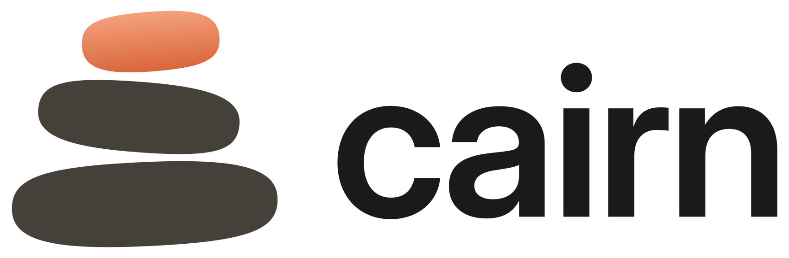

# Cairn identity and design system

<picture>
  <source media="(prefers-color-scheme: dark)" srcset="svg/logo-dark.svg">
  
</picture>

**Cairn** is a clipboard manager for macOS and Windows. A cairn is a stack of stones that marks a path: each copy is a
stone on the stack, the newest on top. The mark is three river stones, the top one in Ember, which is also the colour of
the selected item in both apps.

*Tagline:* Everything you copy, a shortcut away.

Cairn is based on Yippy by Matthew Davidson (MIT). Keep his copyright line in `LICENSE`, and the credit in the About
screens and `THIRD_PARTY_NOTICES.md`, wherever the app ships.

## Files

| Path | What |
| --- | --- |
| `tokens.json` | The single source: brand facts, palette, light and dark themes, contrast rules, radii, spacing, type sizes. |
| `generate.py` | Builds every platform file from the tokens and the artwork it defines. |
| `svg/` | Masters: `mark.svg`, `logo-light.svg` / `logo-dark.svg`, `wordmark-*.svg`, app icons, menu bar icons. |
| `logo-*.png`, `app-icon.png` | Raster copies for places that can't take SVG. |

```sh
python3 -m pip install cairosvg pillow fonttools
python3 brand/generate.py
```

It rewrites, and you commit:

- Windows: `Themes/Light.xaml`, `Themes/Dark.xaml`, `Themes/Tokens.xaml`, `Assets/AppIcon.ico`, the installer's `Wizard*` images.
- macOS: `Assets.xcassets/Tokens/*.colorset` (each with a dark appearance), `AppIcon`, `BetaAppIcon`, `AppLogo`,
  `StatusBarIcon`, `BetaStatusBarIcon`, and `Sources/Constants/DesignTokens.swift`.

Never edit those files by hand. The script stops if a text colour misses its contrast minimum (the `contrast` list in
`tokens.json`), so a palette change can't make either theme unreadable.

## Colour

Two families: **Stone**, warm greys for surfaces and text, and **Ember**, the accent. Moss, Rose and Clay are for
status only (success, favourite, danger).

| Token | Light | Dark | Use |
| --- | --- | --- | --- |
| `PanelBackground` | Stone 100 `#F3F0EB` | Stone 900 `#1C1A18` | Window and panel ground |
| `CardBackground` | Stone 25 `#FFFDFA` | Stone 850 `#252220` | Items, settings cards |
| `CardSelected` | Ember 100 `#FBEDE6` | Ember 900 `#3A2A22` | The selected item, with an `Accent` border |
| `PrimaryText` | Stone 900 | `#F5F1EB` | Body text (15:1 or better) |
| `SecondaryText` | Stone 600 `#5E574F` | `#B5ADA3` | Captions, metadata (6:1 or better) |
| `Accent` | Ember 600 `#AD4722` | Ember 400 `#EE875A` | Selection, primary buttons, focus, toggles |
| `TextOnAccent` | White | `#2A1206` | Text on an accent fill |
| `Link` | Ember 600 | Ember 300 `#F4A27E` | Links in items and settings |
| `Favourite` | Rose 600 `#C2334D` | Rose 300 `#FF8FA3` | The filled heart |
| `Danger` / `Success` | Clay 600 / Moss 600 | Clay 300 / Moss 400 | Errors, confirmations |

The full list (controls, inputs, segments, keycaps, scroll bars) is in `tokens.json`. Every colour in either app comes
from a token: on Windows a `{DynamicResource Yippy.<Token>}` brush, on macOS `DesignTokens.Color.<token>`.

## Type

Each platform's own UI face, so Cairn feels native: **Segoe UI Variable** on Windows (Segoe UI on Windows 10) and
**SF Pro** on macOS. Copied text is set in the UI face at 13 px; file paths and colour values stay monospaced
(Cascadia Mono / SF Mono). The wordmark alone uses Inter Display SemiBold, outlined.

| Token | Size | Weight | Use |
| --- | --- | --- | --- |
| `Title` | 28 | SemiBold | Settings page titles |
| `Subtitle` | 20 | SemiBold | Dialog and About headings |
| `BodyStrong` | 14 | SemiBold | Card headers, section headers |
| `Body` | 14 | Regular | Everything else |
| `Caption` | 12 | Regular | Descriptions, item metadata, key hints |
| `Mono` | 12 | Regular | Paths, hex colours |

## Shape and space

Corners are softer than the platform defaults, like worn stone.

| Radius token | px | Use |
| --- | --- | --- |
| `Small` | 4 | Keycaps, colour swatches |
| `Control` | 6 | Buttons, inputs, segment buttons |
| `Card` | 10 | Items, settings cards, segment track, focus ring |
| `Overlay` | 12 | Menus, flyouts, tooltips |
| `Window` | 14 | The panel, where the OS doesn't round it |

Spacing is a 4 px scale: `XXS` 2, `XS` 4, `S` 8, `M` 12, `L` 16, `XL` 24, `XXL` 32. Cards sit 6 px apart in the panel
and 4 px apart in settings; a card's content is inset by `M`/`L`.

## Components

Both apps draw the same pieces from the same tokens:

- **Item card**: `CardBackground`, 1 px `CardBorder`, `Card` radius. Selected: `CardSelected` fill and `Accent` border
  (Windows adds an Ember pill on the left edge; macOS fills the card's frame with `Accent`). Under the content, the
  source app's icon, name and time in `Caption`/`SecondaryText`, the ⌘/Ctrl+number keycap and the heart.
- **Keycap**: `KeycapBackground`, `KeycapBorder` with a 2 px bottom edge, `Small` radius, `Caption` monospace.
- **Buttons**: standard (`ControlFill`, `ControlBorder`) and accent (`Accent` fill, `TextOnAccent`), `Control` radius,
  32 px tall. One accent button per view at most.
- **Settings card**: icon, `Body` header and `Caption` description on the left, its control on the right.
- **Toggle**, **segmented switch** (Clipboard / Favourites), **search field** (accent underline while typing),
  **menus** and **tooltips** follow the same tokens.
- **Focus**: a 2 px `PrimaryText` ring 3 px outside the control, `Card` radius. Never remove it.

New screens (for example sync settings) should be built from these components and tokens only: no literal colours,
radii or font sizes in views.

## Icons

- **App icon**: the three stones on a Stone 750 to 950 plate; Ember top stone. macOS uses the 824 px plate on the
  1024 grid with its own shadow; Windows uses a full-bleed plate and, up to 32 px, thicker stones with wider gaps.
- **Beta**: the same stones on a Moss plate (macOS app icon) and hollow stones (menu bar).
- **Menu bar** (macOS): solid black stones as a template image, tinted by the system.
- **Tray** (Windows): the app icon's small artwork.
- Clear space around the logo: the height of the top stone. Don't recolour the stones, stretch the mark or set the
  wordmark in another font.

## Names and ids

| | macOS | Windows |
| --- | --- | --- |
| Product | Cairn, Cairn Beta | Cairn (Debug builds: Cairn Dev) |
| Id | `com.hamzashewa.Cairn`, `…CairnBeta`, `…CairnXCTest` | `Cairn.exe`, `%APPDATA%\Cairn`, mutex `Local\Cairn.Instance` |
| Moved over once | `MatthewDavidson.Yippy*` app support and settings | `%APPDATA%\Yippy`, the `Yippy` sign-in entry |

The code keeps Yippy as its internal name (Xcode project, targets, schemes, Swift module, .NET projects, namespaces and
the `Yippy.*` resource keys).
